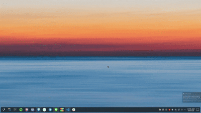

# KDE Screen Dimmer

A lightweight screen dimmer for **KDE Plasma (Wayland)** built with **Qt 6** and **LayerShellQt**.

Screen Dimmer creates a fullscreen translucent overlay using the Wayland layer-shell protocol, allowing the display to be dimmed without changing monitor brightness. It runs as a small background daemon and can be toggled instantly with a keyboard shortcut.

## Features

* Fullscreen dimming overlay
* Adjustable dim level, changeable while the daemon is running
* Works over fullscreen applications and videos
* Click-through overlay (mouse and scroll events pass through)
* Multi-monitor support
* Keyboard shortcut friendly
* Background daemon with negligible CPU usage while idle

## Requirements

* KDE Plasma (Wayland)
* Qt 6
* LayerShellQt
* CMake
* C++20 compatible compiler

## Demo



### Arch Linux / EndeavourOS

```bash
sudo pacman -S qt6-base layer-shell-qt cmake
```

## Build

```bash
git clone https://github.com/<your-username>/screen-dimmer.git
cd screen-dimmer

cmake -B build -DCMAKE_BUILD_TYPE=Release
cmake --build build
```

## Install

```bash
install -Dm755 build/screen-dimmer ~/.local/bin/screen-dimmer
```

## Running

Start the daemon:

```bash
screen-dimmer &
```

Toggle the overlay:

```bash
pkill -USR1 -x screen-dimmer
```

Stop the daemon:

```bash
pkill -x screen-dimmer
```

## Adjusting the Dim Level

The dim level (alpha, 0-255) is read from `$XDG_CONFIG_HOME/screen-dimmer/level`
(defaults to `~/.config/screen-dimmer/level`). The daemon defaults to `150`
if the file is missing or invalid.

Write a new value and send `SIGUSR2` to reload it without restarting the daemon:

```bash
echo 100 > ~/.config/screen-dimmer/level
pkill -USR2 -x screen-dimmer
```

The change applies immediately, whether the overlay is currently visible or not.

## Keyboard Shortcut

A helper script is provided in `scripts/toggle-dimmer.sh`.

Bind the script to a keyboard shortcut from:

### System Settings → Keyboard → Shortcuts → Custom Shortcuts

## Autostart

Copy `scripts/screen-dimmer.desktop` to:

```text
~/.config/autostart/
```

Update the `Exec=` path if necessary.

## Project Structure

```text
.
├── CMakeLists.txt
├── LICENSE
├── README.md
├── src/
│   └── main.cpp
└── scripts/
    ├── screen-dimmer.desktop
    └── toggle-dimmer.sh
```

## Limitations

* Currently tested only on **KDE Plasma Wayland**.
* Requires **LayerShellQt**.
* Other desktop environments and compositors have not been tested.

## License

Released under the MIT License.
